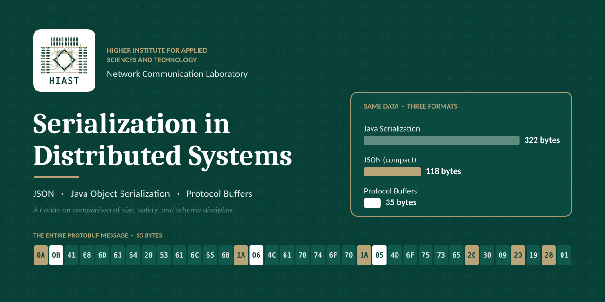

<div align="center">



# Serialization in Distributed Systems

**A hands-on laboratory comparing JSON, Java Object Serialization, and Google Protocol Buffers for transferring complex objects between the nodes of a distributed system.**


</div>

---

## Overview

Distributed systems can only cooperate if they can exchange structured data. Before an object can cross the network it must be **serialized** (converted to text or bytes), and the receiver must **deserialize** it back into an equivalent object. The technique chosen decides message size, interoperability, debuggability, information exposure, and how safely the data format can evolve.

This repository contains the source code and the full written report of a three-part laboratory carried out for the **Network Communication Laboratory** at the **Higher Institute for Applied Sciences and Technology (HIAST)**. All three experiments serialize the same object, a `CustomerPurchaseProfile` from an online store's analytics system, so the results are directly comparable.

| Experiment | Technique | Question it answers |
|---|---|---|
| [1. JSON](json-lab) | Plain-text JSON over HTTP | What goes wrong when there is no schema? |
| [2. Java Serialization](java-serialization-lab) | `Serializable` and `ObjectOutputStream` | What is (and is not) serialized, and what does the payload reveal? |
| [3. Protocol Buffers](protobuf-lab) | `.proto` schema and generated stubs | How small and how safe can a schema-based format be? |

## Key results

The same data (customer name, two product names, two prices, and one boolean flag) serialized with each technique:

| Technique | Message size | Relative to Protobuf |
|---|---:|---:|
| **Protocol Buffers** | **35 bytes** | 1.0x |
| JSON (compact) | 118 bytes | 3.4x |
| Java Serialization | 322 bytes | 9.2x |

Protocol Buffers produced a message about **70% smaller than JSON** and **89% smaller than Java serialization**, and the experiments showed why size is only part of the story:

- **JSON** is open and readable, but a type mismatch between two services was *valid JSON* and failed only at run time.
- **Java serialization** skips `transient` and `static` fields, but the payload embeds class and field names and binds the message to the JVM.
- **Protocol Buffers** identify fields by **number, not name**. Renaming a field on the receiver alone did not break deserialization.

## Repository structure

```text
.
├── json-lab/                  # Experiment 1: JSON and the lack of a schema
│   ├── server.py              #   Flask test service (POST /api/analyze)
│   ├── requirements.txt
│   ├── customer_request.json  #   valid request
│   └── bad_request.json       #   request with prices sent as strings
├── java-serialization-lab/    # Experiment 2: standard Java serialization (IntelliJ project)
│   └── src/
├── protobuf-lab/              # Experiment 3: Protocol Buffers (Maven project)
│   ├── pom.xml
│   ├── customer_profile.proto
│   ├── customer_profile_receiver.proto
│   └── src/main/java/
├── docs/
│   ├── Transferring Objects in DS.pdf
│   └── assets/social-preview.png
├── LICENSE
└── README.md
```

## Prerequisites

| Tool | Used for |
|---|---|
| JDK (the report used OpenJDK 27) and IntelliJ IDEA | Experiments 2 and 3 |
| Apache Maven | Experiment 3 |
| `protoc`, version matching the `protobuf-java` runtime (3.25.x runtime with protoc 25.x) | Regenerating the Protocol Buffers stubs |
| Python 3 with Flask | Experiment 1 test server |
| `curl` | Sending HTTP requests |

## Running the experiments

### Experiment 1: JSON (`json-lab`)

```bash
cd json-lab
python -m venv .venv
# Windows:      .venv\Scripts\activate
# Linux/macOS:  source .venv/bin/activate
pip install -r requirements.txt
python server.py
```

In a second terminal:

```bash
# Valid request: prices are numbers
curl -X POST http://localhost:8080/api/analyze -H "Content-Type: application/json" -d @customer_request.json
# {"customer":"Ahmad Saleh","total":1310}

# Type mismatch: prices are strings
curl -X POST http://localhost:8080/api/analyze -H "Content-Type: application/json" -d @bad_request.json
# {"detail":"unsupported operand type(s) for +: 'int' and 'str'","error":"TypeError"}
```

> **Windows note:** use the Command Prompt, or `curl.exe` in PowerShell (where `curl` is an alias of another command). Single quotes are not treated as quotation marks by the Command Prompt, which is why the JSON is sent from files with `-d @file`.

### Experiment 2: Java Serialization (`java-serialization-lab`)

Open the folder in IntelliJ IDEA and run `JavaSerializationLab.main()`, or compile from the command line:

```bash
cd java-serialization-lab
# Linux/macOS
mkdir -p out && javac -d out src/*.java && java -cp out JavaSerializationLab
```

```powershell
# Windows PowerShell
New-Item -ItemType Directory -Force out | Out-Null
javac -d out (Get-ChildItem src -Filter *.java).FullName
java -cp out JavaSerializationLab
```

Expected observations:

| Observation | Result |
|---|---|
| `tempDiscountToken` (`transient`) after deserialization | `null` |
| `systemVersion` (`static`) after deserialization | the class's *current* value (`v3.0-UPDATED`), because static fields are never serialized |
| Payload size | 322 bytes |
| Adding a non-`Serializable` field (the `Address` test) | `java.io.NotSerializableException: Address` |

### Experiment 3: Protocol Buffers (`protobuf-lab`)

The generated stubs are committed, so the project builds as it is. To regenerate them after editing a schema:

```bash
cd protobuf-lab
protoc --java_out=src/main/java customer_profile.proto
protoc --java_out=src/main/java customer_profile_receiver.proto
```

Open the project in IntelliJ IDEA (Maven reloads the `protobuf-java` dependency) and run, in this order:

1. `ProtobufLab`: builds the object, prints its size, and writes `payload.bin`.
2. `ProtobufReceiver`: reads `payload.bin` and parses it with a schema in which `customer_name = 1` was **renamed** to `full_client_name = 1`.

Expected observations:

| Observation | Result |
|---|---|
| Serialized size | 35 bytes (JSON: 118 bytes) |
| `getCity()` when `city` was never set | `Damascus` (schema default); `hasCity()` is `false`, so the field was not transmitted |
| Receiver with the renamed field | Deserialization succeeds, because the wire format carries **tag numbers**, not names |

> The `WARNING: ... sun.misc.Unsafe ...` lines printed on recent JDKs come from the `protobuf-java` runtime. They are harmless.

## Design guidelines drawn from the lab

| Situation | Recommended | Why |
|---|---|---|
| Browser (JavaScript) sending data to a back end | **JSON** | Native browser support, language independence, easy to debug |
| Fast Java-only prototype on one JVM version | **Java Serialization** | No libraries or compilers; one keyword. Not for production or untrusted input |
| Multi-language, bandwidth-critical system with a strict contract | **Protocol Buffers** | Generated code in many languages, enforced schema, smallest messages |
| Removing a field from a Protobuf schema | Mark its number `reserved` | The tag number is a field's only identity on the wire; reusing it corrupts old data |

## Report

The complete written report covers the objectives, procedures, source code, annotated screenshots, measurements, and the answers to all report and discussion questions:

- [Transferring Objects in DS.pdf](docs/Transferring%20Objects%20in%20DS.pdf)

## Author

**Eng. Mohammad Ghaith al-Atrash**
Higher Institute for Applied Sciences and Technology (HIAST), Syrian Arab Republic

## License

Released under the [MIT License](LICENSE).
